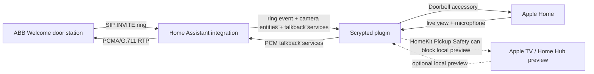
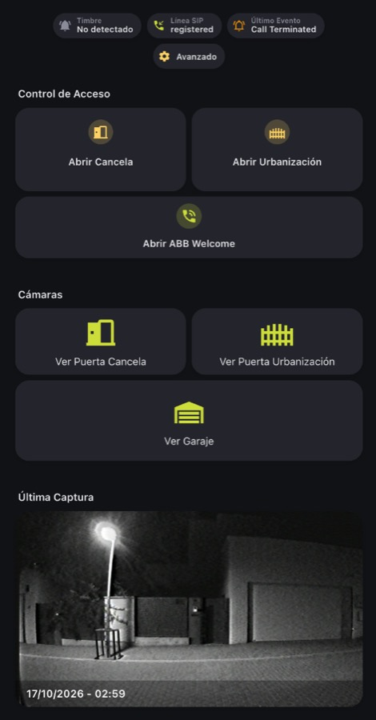
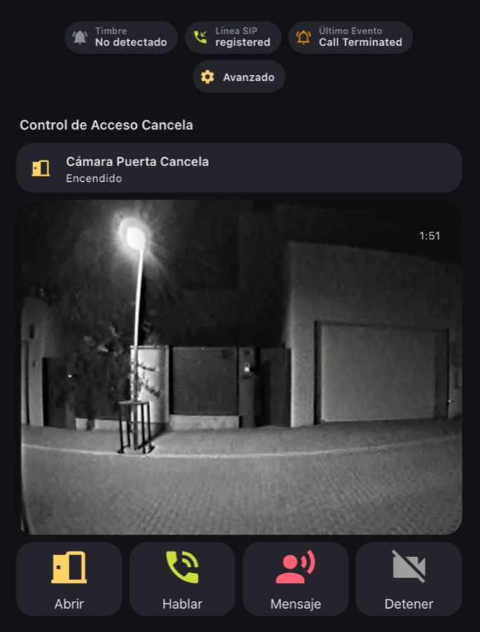
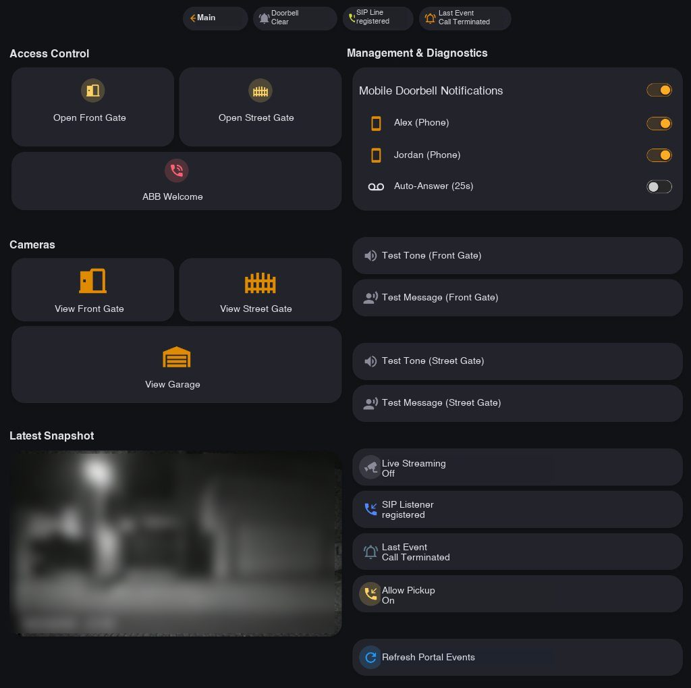

# ABB Welcome - Home Assistant integration

[](https://my.home-assistant.io/redirect/hacs_repository/?owner=rankjie&repository=ha-abb-welcome&category=integration)

Local controls, ring detection, and live intercom streams for ABB Welcome /
Busch-Jaeger building intercoms backed by a web-admin **IP gateway** (system
type `mrange`) or an app-managed M2240x/ASI22 Wi-Fi indoor station.

This integration is LAN-first. Pairing uses the ABB MyBuildings cloud portal
once, then unlocks, realtime ring detection, and live video/audio run directly
against the gateway on your local network.

For Apple Home / HomeKit, use the companion
[ABB HA Doorbell Scrypted plugin][scrypted-bridge]. The Scrypted plugin imports
ABB Welcome stations into Apple Home as full HomeKit doorbells with live video,
doorbell notifications, and two-way audio.

> [!IMPORTANT]
> **Want ABB Welcome in Apple Home? Use Scrypted.**
>
> HA's native HomeKit bridge can expose a basic camera/ring sensor, but it does
> not provide the full HomeKit doorbell experience. For Apple Home notifications,
> live video, audio, talkback, and safer pickup handling, install this HA
> integration first, then add the companion
> [ABB HA Doorbell Scrypted plugin][scrypted-bridge].

## Features

- One Home Assistant **button entity per unlock-capable outdoor station**,
  plus a **Second lock** button when the station reports that capability.
- **Camera entities** for discovered door stations, backed by HA's bundled
  go2rtc/WebRTC path.
- **LAN H.264 video + PCMA/G.711 audio** for live intercom streams.
- **Talkback services** for the active stream. The Scrypted plugin uses these to
  provide HomeKit microphone audio.
- **Streaming enabled switch** to explicitly arm live streaming. Turning it off
  tears down active streams and hangs up active calls.
- **Allow pickup switch** for incoming doorbell calls. When disabled, HA will not
  accept the ringing INVITE, leaving phones and indoor stations free to answer.
- **Realtime ring binary sensor** that listens for local SIP INVITE packets and
  fires quickly when someone presses the doorbell.
- `abb_welcome_ring` Home Assistant event with station id, station name, caller
  URI, call id, and timestamp.
- **Image entity** with the latest gateway screenshot from event history.
- **Event entity** and **last-event sensor** for ring / call / door-open history.
- **Refresh Events** button for a manual portal event poll.
- **Refresh outdoor stations** service for re-reading the door list on
  web-admin gateways. App-managed topology currently requires re-pairing.
- Switchable unlock strategy for gateways that need a different SIP unlock path.
- LAN RTSP proxy for Scrypted/HomeKit, with automatic free-port selection and
  discovery refresh events.

## Requirements

- A supported ABB Welcome device reachable on your local network:
  - ABB **83342** or another `mrange` IP gateway with web admin, or
  - an **M2240x/ASI22 Wi-Fi indoor station** with SIP-TLS port 5061 reachable.
- An **ABB-Welcome / Busch-Jaeger MyBuildings** account already linked to that
  gateway.
- For web-admin gateways only, the gateway admin password used at
  `https://<gateway-ip>/`.
- For app-managed devices with more than one device on the MyBuildings
  account, the device's **Portal UUID**; otherwise setup finds it.
- For Apple Home: a working Scrypted installation and the
  [ABB HA Doorbell Scrypted plugin][scrypted-bridge].

## Installation

### HACS

Click the badge to add this repository to HACS:

[](https://my.home-assistant.io/redirect/hacs_repository/?owner=rankjie&repository=ha-abb-welcome&category=integration)

Then install **ABB Welcome** from HACS and restart Home Assistant.

If the badge does not work, open HACS -> **Custom repositories**, add
`https://github.com/rankjie/ha-abb-welcome` as an *Integration*, and install it.

### Manual

Copy `custom_components/abb_welcome/` into Home Assistant's
`config/custom_components/` directory and restart Home Assistant.

## Home Assistant Setup

Open Settings -> **Devices & Services** -> **Add Integration** -> **ABB Welcome**.

First choose a device profile:

- **Web-admin IP gateway (83342 / MRANGE)** keeps the existing HTTPS/CGI setup.
- **App-managed Wi-Fi indoor station (M2240x / ASI22)** uses SIP-TLS port 5061
  and MyBuildings app pairing; it never contacts port 443
  or asks for a gateway admin password.

For a **Busch-Jaeger IP touch 7** (firmware 3.08) with a Smart Access Point
(V6.66), enter the **touch panel's IP address** in the app-managed profile.
The owner verified pairing, ring detection and live video with
`v1.8.0-dev4`. The panel identifies itself as `GlobalIP` and explicitly
grants HA permission to open the door. With the Standard strategy, the panel
acknowledges the SIP message but the door stays locked. Re-pairing to obtain
that permission is unnecessary. [Pairing diagnostics](https://github.com/rankjie/ha-abb-welcome/issues/45#issuecomment-6985603402)

With the published `v1.8.0-dev5`, the door also stayed locked during an
active HA live view. The owner confirmed that a locally modified dev5
opened the primary lock twice through the outdoor station's Lock-GND output.
The subsidiary relay was not tested. [Field results](https://github.com/rankjie/ha-abb-welcome/issues/45#issuecomment-6989189437)

On this installation, enabling the Smart AP's SIP server interrupted calls
from the H81381P1-S-03 outdoor station to the indoor panel. Keep it off for
this pairing. [Hardware test results](https://github.com/rankjie/ha-abb-welcome/issues/45#issuecomment-6985197643)

For an app-managed entry, **Download diagnostics** checks the latest retained
pairing record for the panel's system type and this HA client's door-opening
permission. Only share the `pairing_acl` section. A missing record or an
unknown permission leaves the grant unconfirmed.

Then fill in:

- MyBuildings portal **username**
- MyBuildings portal **password**
- Gateway local **IP address**
- Gateway **web admin password** (web-admin profile only)
- Gateway **Portal UUID** (optional)

Optional: if neither the local `portalclient.cgi` endpoint nor the MyBuildings
discovery list gives the gateway UUID, fill in **Gateway Portal UUID** from the
gateway web admin Portal page or ABB Welcome mobile app, then retry.

Both profiles:

1. Determine the gateway UUID before anything is registered on MyBuildings.
2. Generate a fresh RSA keypair and request a client certificate from the
   MyBuildings portal. Each certificate appears as an `ha-*` client, so a retry
   in the same setup dialog with the same portal account reuses it.
3. Compute the gateway integrity code from the certificate fingerprint.
4. Send a `welcome.connect` event so the device sees a pending pairing.
5. Poll for the gateway ACL update, decrypt the SIP password, read the door
   list, and create HA entities.

The setup dialog shows which stage is running and counts the ACL checks.

For a web-admin gateway, setup reads the gateway UUID from its CGI (unless an
override was supplied), then logs into the CGI to approve the pending client.
If the CGI returns no UUID, setup takes the IP gateway listed in the MyBuildings
discovery list, or asks you to choose when the account has several.
For an app-managed device, setup reads the MyBuildings discovery list with the
new certificate and sends the pairing request to the gateway or Wi-Fi indoor
station listed there, the same way the official app picks its target. An entered
Portal UUID is used when it is in that list. If it is not, and the account has
exactly one device, that device is used instead. With several devices, setup
lists them and asks for one. Setup never calls the local CGI.

A successful web-admin pairing typically completes in under 15 seconds.

For an app-managed device, the integration creates one `ha-*` client, persists
the identity, and waits about 90 seconds for the ACL update. It alternates the
plain ACL query with the query the official app uses for Wi-Fi indoor stations.
M2240x/ASI22 additional apps normally pair automatically when they use the same
MyBuildings account; the M22403-W has no approval screen on the panel. If no
ACL arrives, the dialog shows the client name and integrity code, and **Submit**
sends the pairing request again with the same identity before checking for
another round. An `ha-*` client shown as active in MyBuildings only has a
certificate; it is paired once the device has sent its ACL.

The pending private identity is stored in Home Assistant's private storage. A
later config flow can resume the same certificate, client identity, and
`welcome.connect` request after a browser reload or Home Assistant restart; it
does not consume another client slot. MyBuildings credentials are used only for
the initial certificate request and the password is not stored. The recovery
screen also provides an explicitly confirmed discard path for clients that have
already been removed/unpaired.

## Apple Home / HomeKit

> [!IMPORTANT]
> **Full Apple Home doorbell = HA integration + Scrypted plugin.**
>
> Do **not** rely on HA's native HomeKit bridge if you want a real Apple Home
> doorbell. HA can expose a one-way camera and ring sensor, but the usable
> HomeKit microphone path, Apple Home doorbell accessory, and pickup-safety
> controls are provided by the companion
> [ABB HA Doorbell Scrypted plugin][scrypted-bridge].

| Goal | Use |
|---|---|
| Door buttons, HA cameras, ring events, SIP/RTP media, talkback services | This Home Assistant integration |
| Import ABB stations into Apple Home as full HomeKit doorbells | [ABB HA Doorbell Scrypted plugin][scrypted-bridge] |
| HomeKit microphone / two-way audio | Scrypted plugin, backed by HA talkback services |
| Apple TV/Home Hub preview blocking | Scrypted plugin **HomeKit Pickup Safety** |
| Basic one-way HomeKit camera only | HA native HomeKit bridge, if you do not need talkback |



Recommended setup:

1. Install and configure this HA integration.
2. Confirm the HA camera stream works by turning on
   `switch.<gateway>_streaming_enabled` and opening a camera.
3. Install the [Scrypted plugin][scrypted-bridge].
4. In the Scrypted plugin settings, enter:
   - **Home Assistant URL**
   - **Home Assistant Token** (a long-lived access token)
5. Leave **Primary Door Station** blank unless you want a specific station to
   keep the existing `front-door` HomeKit identity.
6. Add the Scrypted doorbells to Scrypted's HomeKit plugin.
7. Keep Scrypted HomeKit **Transcode Video** and **Transcode Audio** enabled.
   The plugin enables them automatically, but they should stay on for reliable
   Home app video and audio.

The Scrypted plugin discovers HA camera entities, station ids, ring state,
snapshot image data, the streaming switch, and each camera's `lan_rtsp_url`.
When HA reloads or moves the LAN RTSP proxy to another port, it fires
`abb_welcome_discovery_changed`; Scrypted listens for that event and refreshes
without subscribing to every HA entity.

### Doorbell Ring Flow

The intended Apple Home flow is:

1. Someone presses a door station.
2. HA receives the local SIP `INVITE`.
3. HA fires `abb_welcome_ring` and updates the ring binary sensor.
4. Scrypted turns that into a HomeKit doorbell notification.
5. If the user opens the Home notification or live view, Scrypted asks HA for the
   matching stream.
6. HA accepts the pending incoming call for that station, or proactively dials
   the station for manual live view.
7. HomeKit receives video/audio, and HomeKit microphone audio is sent back
   through HA talkback services.

Receiving the ring does **not** answer the intercom by itself. HA only arms the
stream. The call is accepted when a real stream consumer opens the camera.

### Allow Pickup

`switch.<gateway>_allow_pickup` controls whether HA/Scrypted/HomeKit may answer
an incoming ringing call.

- **On**: an incoming ring arms streaming for that station. Opening the matching
  camera from HomeKit can pick up the ringing call.
- **Off**: an incoming ring force-disarms streaming. HA still reports the ring,
  but it refuses HomeKit/Scrypted pickup so phones and indoor stations can
  answer safely.

This is independent from manual proactive streaming. You can still turn on
`Streaming enabled` and open a camera outside a ring.

### Apple TV / Home Hub Preview

Apple TV and some Home Hubs may open a local preview immediately after a
doorbell ring. ABB Welcome intercom media is exclusive, so an automatic preview
can occupy the call before a person answers.

If Apple Home uses an Apple TV or Home Hub:

- Configure **HomeKit Pickup Safety** in the Scrypted plugin.
- Assign the Apple TV/Home Hub a fixed LAN IP if possible.
- Enter that IP in Scrypted's **Apple TV / Home Hub IPs** setting if you want
  automatic local previews blocked.
- Leave the IP field blank if you do not want preview blocking.
- Do not enable Scrypted Rebroadcast or Prebuffer for ABB doorbells.

The Scrypted block only rejects matching **local** HomeKit preview requests
during the ring window. Manual Home app viewing and remote viewing through the
same Home Hub remain allowed.

## Entities

The integration creates one HA device for the gateway.

For each unlock-capable outdoor station:

- `button.<gateway>_<door_name>` - unlocks that station.
- `camera.<gateway>_<door_name>` - live intercom stream for that station.

Gateway-level entities:

- `switch.<gateway>_streaming_enabled` - arms stream startup for a short window.
  Turning it off tears down active streams/calls.
- `switch.<gateway>_allow_pickup` - allows or refuses incoming-call pickup.
- `binary_sensor.<gateway>_intercom_ringing` - turns on briefly when a SIP ring
  is observed.
- `image.<gateway>_latest_screenshot` - latest gateway screenshot from event
  history.
- `event.<gateway>_intercom` - ring / call / door-open event entity.
- `sensor.<gateway>_last_event` - latest non-screenshot portal event.
- `sensor.<gateway>_sip_listener` - diagnostic state for the realtime SIP
  listener.
- `button.<gateway>_refresh_events` - manually poll portal event history.

Unlock example:

```yaml
service: button.press
target:
  entity_id: button.abb_welcome_outdoor_1
```

## Streaming

ABB intercom media is exclusive, so live streams are gated.

Manual stream:

1. Turn on `switch.<gateway>_streaming_enabled`.
2. Open the desired `camera.<gateway>_<door_name>` within the armed window.
3. HA dials the selected station and passes H.264 video plus PCMA/G.711 audio to
   go2rtc/WebRTC and to Scrypted/HomeKit.

Turning off `switch.<gateway>_streaming_enabled` immediately disarms streaming
and closes active stream sessions.

The switch exposes useful attributes:

- `reason`: why streaming is armed (`manual`, `ring`, etc.).
- `target_station_id`: station id allowed during a ring-scoped arm.
- `remaining_seconds`: time left in the arm window.

You can also arm streaming from an automation:

```yaml
service: abb_welcome.arm_streaming
data:
  station_id: "100000001"
  duration: 60
```

## Talkback

HA exposes talkback as services for the currently active stream. These services
are mainly intended for the Scrypted plugin.

- `abb_welcome.talk_start`
- `abb_welcome.talk_stop`
- `abb_welcome.talk_pcm16le`
- `abb_welcome.talk_tone`

The audio format for `talk_pcm16le` is base64-encoded 8 kHz mono signed 16-bit
little-endian PCM. HA converts it to continuous PCMA/G.711 A-law RTP on the
active call's audio leg. Idle talkback sends silence continuously, and voice
frames are queued into the same RTP sequence.

Scrypted assigns a per-client `talkback_session_id` so stale clients cannot stop
or overwrite a newer microphone session.

## Scrypted RTSP Endpoint

Scrypted needs a LAN-reachable RTSP URL. HA's bundled go2rtc RTSP listener is
localhost-only, so this integration serves its own camera streams through a
small LAN RTSP proxy.

The proxy has no authentication: any device on the LAN can play the ABB camera
streams. It forwards playback requests for this integration's streams only, so
other Home Assistant cameras in go2rtc are not reachable through it, and it
rejects publishing. If you do not use Scrypted or another LAN RTSP client, turn
it off with **Serve camera streams to the LAN over RTSP** in the integration
options.

Port selection starts at:

```text
rtsp://<home-assistant-lan-ip>:18556/<go2rtc_stream>
```

Each camera exposes:

- `go2rtc_stream`: the stream name, such as `abb_100000001`.
- `lan_rtsp_url`: the complete URL Scrypted should use.
- `lan_rtsp_proxy_port`: the selected proxy port.
- `lan_rtsp_proxy_running`: whether the proxy is running.

On setup/reload, the integration tries the saved preferred port first. If that
port is occupied, it scans upward from `18556`, starts on the first free port,
and persists the new port in the config entry options. This avoids requiring a
hard-coded reserved port.

After camera entities load, HA fires `abb_welcome_discovery_changed` with the
current proxy host, port, running state, and change reason. The Scrypted plugin
uses that event to refresh its station list and RTSP URLs.

## Services

- `abb_welcome.refresh_doors` - re-read outdoor stations from a web-admin
  gateway and reload the entry if the list changed. App-managed devices return
  an unsupported error; re-pair after topology changes.
- `abb_welcome.arm_streaming` - arm streaming for all stations or one
  `station_id`.
- `abb_welcome.talk_start` - start sending queued microphone audio on the active
  stream.
- `abb_welcome.talk_stop` - stop voice audio and return the talkback leg to
  silence.
- `abb_welcome.talk_pcm16le` - queue base64 PCM16LE microphone audio.
- `abb_welcome.talk_tone` - send a short generated tone for testing.
- `abb_welcome.export_credentials` - export stored SIP/gateway credentials to a
  JSON file for local debugging. This output contains secrets. Admin users
  only; the file must be inside the config directory but not in `www/`, and
  is written with owner-only (0600) permissions.
- `abb_welcome.diagnose_messages` - temporarily publish sanitized inbound SIP
  MESSAGE bodies for protocol investigation. Disabled by default; accepts an
  optional `entry_id` and a `duration` of 0–600 seconds (default 300). Zero stops
  diagnostics, and an integration reload clears the window.

## SIP MESSAGE Diagnostics

To investigate physical programmable buttons, open **Developer Tools → Events**
and start listening to `abb_welcome_sip_message`. Then run this action in
**Developer Tools → Actions**:

```yaml
action: abb_welcome.diagnose_messages
data:
  duration: 300
```

Press the configured physical button several times, with a few seconds between
presses. Record the press times and the resulting events. Compare different
unused actuator addresses and both buttons. Supplying `entry_id` restricts the
diagnostic window to that integration entry.

Each event contains `entry_id`, `received_at`, `body_bytes`, `body_format`,
`body_redacted`, and a sanitized `body` string. Known SIP commands and supported
button parameters, such as button ID, function and actuator address, remain
readable. Private fields, unknown values and unknown JSON field names are
masked; an unrecognized text body may therefore show only `<redacted>`.
Binary bodies and bodies larger than 4096 bytes are omitted. SIP headers,
authentication data and media keys are not published.

For example, an inbound camera-count MESSAGE produces:

```json
{
  "entry_id": "your-entry-id",
  "received_at": 1791028800.0,
  "body_bytes": 3,
  "body_format": "text",
  "body_redacted": false,
  "body": "c:2"
}
```

This observes messages delivered to the integration's SIP client. It does not
guarantee that the panel sends physical button actions to that client. Confirm
normal doorbell reception before interpreting an empty diagnostic window. The
event is for temporary diagnosis; physical programmable-button automations are
not yet supported.

## Realtime Ring Event

Every incoming SIP ring fires `abb_welcome_ring` on the Home Assistant event bus.

Example payload:

```json
{
  "caller_uri": "sip:100000001@ipgw6cce7a2bb673;user=phone",
  "caller_user": "100000001",
  "station_id": "100000001",
  "station": "Outdoor 1",
  "station_name": "Outdoor 1",
  "call_id": "1293890397@192.168.178.112",
  "received_at": 1777723346.1623127
}
```

Automation example:

```yaml
condition:
  - condition: template
    value_template: "{{ trigger.event.data.station_id == '100000001' }}"
```

## Options

Open the integration's **Configure** menu to change behavior after setup.

Options:

- **Unlock strategy**
- **Physical default door for Hybrid fast path**: app-managed devices only.
  Select the door that the physical indoor panel itself opens by default.
  Home Assistant cannot discover this setting.
- **Advertised Home Assistant LAN host**: blank means auto-detect.
- **Preferred LAN RTSP proxy port**: tried first; HA falls back to another free
  port if it is occupied.
- **Allow pickup from streams**: default for the `Allow pickup` switch.

### Unlock Strategy

| Strategy | What it does | When to use |
|---|---|---|
| **Hybrid** *(web-admin default)* | Plain SIP `MESSAGE` for the physical default station, `INVITE`-then-`MESSAGE` for every other station. | App-managed devices require an explicit physical-default selection. Web-admin legacy entries retain their first-stored-door behavior. |
| **Fast** | Plain SIP `MESSAGE` without first establishing a targeted call. | Allowed for app-managed devices only when one unlockable door exists. It is blocked with multiple doors because the panel may ignore the requested target. |
| **Standard** *(app-managed default)* | TLS `INVITE` to bring the call up, then `MESSAGE`, then `BYE`. | Uses the required SIP-TLS port 5061 and avoids assuming port 5060 is available. Adds roughly 1-2 seconds per unlock. |

Second-lock buttons always establish a targeted call, send the MRANGE second-lock
command `a`, and hang up, including when Fast or Hybrid is selected. The first
lock keeps the selected strategy. Second-lock availability comes from the
gateway device list or the pairing ACL's `secondunlock` flag. Reload the
integration or run `abb_welcome.refresh_doors` after changing this setting on a
web-admin gateway; app-managed topology changes require re-pairing.

If a door does not open with Hybrid, switch to **Standard**. Do not use Fast to
test targeting on a multi-door app-managed device: the physical panel may
ignore the requested station and open its own default door.
The app-managed profile defaults to **Standard**. Its physical indoor-panel
default is not exposed by the protocol, so Home Assistant does not guess from
door-list order. To use Hybrid, first confirm which door the physical panel
opens by default and select that exact door in Configure. If the selected
station disappears after re-pairing or topology changes, every Hybrid unlock
falls back to Standard; another door is never selected silently.

## Example Intercom Dashboard & Automations

<p align="center">
  
  &nbsp;
  
  &nbsp;
  
</p>

### Standby, Active Call, and Diagnostics UI Flow
* **In Standby:** Displays door unlock buttons, direct camera view triggers, and the latest visitor screenshot.
* **During a Ring / Active Call:** Reveals the live video feed (`camera.<gateway>_<door_name>`) with quick-action buttons:
  - **Open:** Unlocks the door (`button.press`).
  - **Message:** Broadcasts a pre-recorded absence message through the outdoor speaker (`abb_welcome.talk_audio_file`).
  - **Stop:** Disarms live streaming (`switch.turn_off`).
* **Technical & Diagnostics:** Shows live SIP listener state, last event, `allow_pickup` toggle, and `refresh_events` button.

<details>
<summary>Example Dashboard View YAML (replace <code>&lt;gateway&gt;</code> and <code>&lt;door_name&gt;</code> with your entity IDs)</summary>

```yaml
title: ABB Welcome Intercom
path: abb-intercom
icon: mdi:doorbell-video
type: sections
badges:
  - type: entity
    entity: binary_sensor.<gateway>_intercom_ringing
    name: Ringing
  - type: entity
    entity: sensor.<gateway>_sip_listener
    name: SIP Listener
  - type: entity
    entity: sensor.<gateway>_last_event
    name: Last Event
sections:
  - cards:
      - type: conditional
        conditions:
          - entity: switch.<gateway>_streaming_enabled
            state: "on"
        card:
          type: vertical-stack
          cards:
            - type: picture-entity
              entity: camera.<gateway>_<door_name>
              camera_view: live
              show_state: false
              show_name: false
            - type: grid
              columns: 3
              square: false
              cards:
                - type: button
                  name: Open
                  icon: mdi:door-open
                  tap_action:
                    action: perform-action
                    perform_action: button.press
                    target:
                      entity_id: button.<gateway>_<door_name>
                    confirmation:
                      text: Unlock the door?
                - type: button
                  name: Message
                  icon: mdi:account-voice
                  tap_action:
                    action: perform-action
                    perform_action: abb_welcome.talk_audio_file
                    data:
                      entity_id: camera.<gateway>_<door_name>
                      file_path: "/media/abb_welcome/intercom_mensaje.wav"
                - type: button
                  name: Stop
                  icon: mdi:video-off
                  tap_action:
                    action: perform-action
                    perform_action: switch.turn_off
                    target:
                      entity_id: switch.<gateway>_streaming_enabled
      - type: tile
        entity: button.<gateway>_<door_name>
        name: Unlock Door
        icon: mdi:door-open
      - type: button
        name: View Live Camera
        icon: mdi:video
        tap_action:
          action: perform-action
          perform_action: abb_welcome.arm_streaming
      - type: picture-glance
        title: Latest Screenshot
        image_entity: image.<gateway>_latest_screenshot
        entities:
          - entity: binary_sensor.<gateway>_intercom_ringing
  - cards:
      - type: entities
        title: Diagnostics & Controls
        entities:
          - entity: switch.<gateway>_streaming_enabled
          - entity: switch.<gateway>_allow_pickup
          - entity: sensor.<gateway>_sip_listener
          - entity: sensor.<gateway>_last_event
          - entity: button.<gateway>_refresh_events
```

</details>

### Automation: Doorbell Answering Machine (Absence Message)

Broadcast a pre-recorded 8 kHz mono 16-bit PCM WAV file to the outdoor station when someone rings the doorbell and nobody is home.

**Prerequisites:**
- Requires `abb_welcome.talk_audio_file` ([#43](https://github.com/rankjie/ha-abb-welcome/pull/43)).
- **Allow pickup** (`switch.<gateway>_allow_pickup`) must be enabled so Home Assistant can answer the pending incoming call (and arm streaming for the ringing station).
- The WAV file path must be allowlisted in Home Assistant. `/media/...` (Home Assistant's configured media directory) and `/config/www/...` are allowlisted by default; if you store files in another folder such as `/config/abb_welcome`, add it to `configuration.yaml`:
  ```yaml
  homeassistant:
    allowlist_external_dirs:
      - /config/abb_welcome
  ```

```yaml
alias: "ABB Welcome: Absence Message on Doorbell Ring"
description: "Broadcast an absence message to the outdoor station if home is unoccupied"
trigger:
  - platform: state
    entity_id: binary_sensor.<gateway>_intercom_ringing
    to: "on"
condition:
  - condition: state
    entity_id: group.family  # or person.your_name
    state: "not_home"
action:
  - delay: "00:00:03"  # Brief pause after first ring tone
  - action: abb_welcome.talk_audio_file
    data:
      entity_id: camera.<gateway>_<door_name>  # target the intended/ringing camera
      file_path: "/media/abb_welcome/intercom_mensaje.wav"
```

### Automation: Actionable Mobile Notification

Send an instant mobile notification with the visitor screenshot and handle the `OPEN_GATE` and `SEND_MESSAGE` button taps (for multi-door setups, bind `entity_id` to the intended/ringing camera):

```yaml
alias: "ABB Welcome: Doorbell Ring Notification & Actions"
mode: parallel
trigger:
  - platform: state
    entity_id: binary_sensor.<gateway>_intercom_ringing
    to: "on"
    id: ring
  - platform: event
    event_type: mobile_app_notification_action
    event_data:
      action: OPEN_GATE
    id: open_gate
  - platform: event
    event_type: mobile_app_notification_action
    event_data:
      action: SEND_MESSAGE
    id: send_message
action:
  - choose:
      - conditions:
          - condition: trigger
            id: ring
        sequence:
          - action: notify.mobile_app_<device>
            data:
              title: "Doorbell Ring!"
              message: "Someone is at the front gate."
              data:
                image: "/api/image_proxy/image.<gateway>_latest_screenshot"
                actions:
                  - action: "OPEN_GATE"
                    title: "Open Gate"
                  - action: "SEND_MESSAGE"
                    title: "Play Absence Message"
      - conditions:
          - condition: trigger
            id: open_gate
        sequence:
          - action: button.press
            target:
              entity_id: button.<gateway>_<door_name>
      - conditions:
          - condition: trigger
            id: send_message
        sequence:
          - action: abb_welcome.talk_audio_file
            data:
              entity_id: camera.<gateway>_<door_name>
              file_path: "/media/abb_welcome/intercom_mensaje.wav"
```

## Troubleshooting

- **Cannot reach the gateway web admin on HTTPS port 443**: check the gateway IP
  and that Home Assistant can route to it.
- **Cannot reach SIP-TLS port 5061**: for an app-managed device, check its local
  IP, Wi-Fi connection, and routing from Home Assistant.
- **No ACL update after app pairing**: submit again to resend the pairing
  request. If the indoor station lists a pending app under System Settings ->
  APP Settings, approve it there. If the config-flow page disappears, start
  ABB Welcome setup again and choose the app-managed profile; Home Assistant
  offers to resume the saved identity, which resends the pairing request
  without creating another MyBuildings client.
- **Any setup failure**: the error page ends with a **Debug report** box holding
  the setup's DEBUG log with passwords, IPs, UUIDs and certificates redacted.
  Copy the whole box into a GitHub issue.
- **Invalid portal credentials**: the MyBuildings portal rejected the username or
  password.
- **Gateway admin password is wrong**: log into `https://<gateway-ip>/` manually
  as `admin` to confirm the password.
- **Could not read the gateway's portal UUID**: fill in **Gateway Portal UUID**
  manually and retry.
- **The gateway did not see our pairing request**: retry pairing; the
  portal-to-gateway link may have been briefly delayed.
- **A door does not open**: try **Standard** unlock strategy. The IP touch 7
  owner already tested this strategy on the setup described above. With the
  published dev5 integration, use the Welcome app to open that door.
- **WebRTC says `wrong response on DESCRIBE`**: turn on `Streaming enabled` and
  open the camera within the armed window.
- **Camera has video but no audio**: confirm you are on a current version and
  that the stream includes the PCMA/G.711 audio track.
- **HomeKit has video but no microphone**: add the doorbells through the
  [Scrypted plugin][scrypted-bridge], not only through HA's native HomeKit
  bridge.
- **Apple TV opens a preview by itself**: configure Scrypted **HomeKit Pickup
  Safety**, enter the Apple TV/Home Hub fixed LAN IP, and keep
  Rebroadcast/Prebuffer disabled for ABB doorbells.
- **Scrypted cannot load stream after HA reload**: click **Refresh Discovery** in
  the Scrypted plugin, or check the camera `lan_rtsp_url` attribute.
- **WebRTC live stream works on local Wi-Fi but hangs or fails on mobile data (5G/4G)**:
  Mobile network carriers implement Carrier-Grade NAT (CGNAT) with symmetric NAT,
  which prevents direct STUN peer-to-peer negotiation. Configure an ICE TURN relay
  server (such as `coturn`) in `go2rtc.yaml` under `webrtc: ice_servers:` to allow
  media packets to relay smoothly.

## Tested Hardware

- **ABB 83342 IP Gateway**, firmware `ASM04_GW_V6.25_20250513_MP_TIDM365`,
  system type `mrange`, 3 outdoor stations.
- **ABB M22403-W Wi-Fi indoor station**, firmware
  `ASI22_V1.23_20251225_PP_IMX6SOLO`, system type `ASI22`, 2 outdoor stations.
  Validated with automatic MyBuildings app pairing and recovery, SIP-TLS
  registration after restart, per-station ring detection and unlock, H.264
  video, PCMA/G.711 audio, portal history and screenshots, call pickup, and
  two-way talkback. App-managed door topology refresh remains the documented
  exception and requires re-pairing.

Reports for other models and firmware versions are welcome.

## License

MIT - see [LICENSE](LICENSE).

[scrypted-bridge]: https://github.com/rankjie/abb-ha-doorbell
