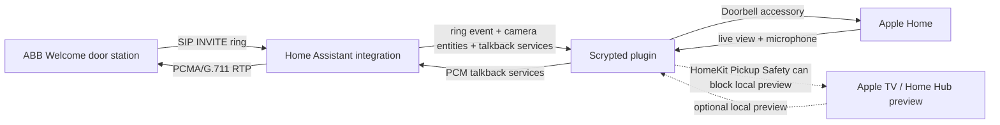

# Apple Home / HomeKit

> [!IMPORTANT]
> **Full Apple Home doorbell = HA integration + Scrypted plugin.**
>
> Do **not** rely on HA's native HomeKit bridge if you want a real Apple Home
> doorbell. HA can expose a one-way camera and ring sensor, but the usable
> HomeKit microphone path, Apple Home doorbell accessory, and pickup-safety
> controls are provided by the companion
> [ABB HA Doorbell Scrypted plugin][scrypted-bridge].

| Goal | Use |
|---|---|
| Door buttons, HA cameras, ring events, SIP/RTP media, talkback services | This Home Assistant integration |
| Import ABB stations into Apple Home as full HomeKit doorbells | [ABB HA Doorbell Scrypted plugin][scrypted-bridge] |
| HomeKit microphone / two-way audio | Scrypted plugin, backed by HA talkback services |
| Opening the door from Apple Home | Scrypted plugin lock, which presses the HA door button |
| Apple TV/Home Hub preview blocking | Scrypted plugin **HomeKit Pickup Safety** |
| Basic one-way HomeKit camera only | HA native HomeKit bridge, if you do not need talkback |



Recommended setup:

1. Install and configure this HA integration.
2. Confirm the HA camera stream works by turning on
   `switch.<gateway>_streaming_enabled` and opening a camera.
3. Install the [Scrypted plugin][scrypted-bridge].
4. In the Scrypted plugin settings, enter:
   - **Home Assistant URL**
   - **Home Assistant Token** (a long-lived access token)
5. Leave **Primary Door Station** blank unless you want a specific station to
   keep the existing `front-door` HomeKit identity.
6. Add the Scrypted doorbells to Scrypted's HomeKit plugin.
7. Keep Scrypted HomeKit **Transcode Video** and **Transcode Audio** enabled.
   The plugin enables them automatically, but they should stay on for reliable
   Home app video and audio.
8. To open the door from Apple Home, also add the station's Scrypted lock to
   the HomeKit plugin and put it in the same room as the doorbell. Apple Home
   then offers the lock in the doorbell's live view and ring notification.

The Scrypted plugin discovers HA camera entities, station ids, ring state,
snapshot image data, the streaming switch, and each camera's `lan_rtsp_url`
and `unlock_button_entity_id`.
The doorbell snapshot is the camera's still image, so keep the option **Show
the last station screenshot as the camera still image** turned on.
When HA reloads or moves the LAN RTSP proxy to another port, it fires
`abb_welcome_discovery_changed`; Scrypted listens for that event and refreshes
without subscribing to every HA entity.

## Doorbell ring flow

The intended Apple Home flow is:

1. Someone presses a door station.
2. HA receives the local SIP `INVITE`.
3. HA fires `abb_welcome_ring` and updates the ring binary sensor.
4. Scrypted turns that into a HomeKit doorbell notification.
5. If the user opens the Home notification or live view, Scrypted asks HA for the
   matching stream.
6. HA accepts the pending incoming call for that station, or proactively dials
   the station for manual live view.
7. HomeKit receives video/audio, and HomeKit microphone audio is sent back
   through HA talkback services.

Receiving the ring does **not** answer the intercom by itself. HA only arms the
stream. The call is accepted when a real stream consumer opens the camera.

## Apple TV / Home Hub preview

Apple TV and some Home Hubs may open a local preview immediately after a
doorbell ring. ABB Welcome intercom media is exclusive, so an automatic preview
can occupy the call before a person answers.

If Apple Home uses an Apple TV or Home Hub:

- Configure **HomeKit Pickup Safety** in the Scrypted plugin.
- Assign the Apple TV/Home Hub a fixed LAN IP if possible.
- Enter that IP in Scrypted's **Apple TV / Home Hub IPs** setting if you want
  automatic local previews blocked.
- Leave the IP field blank if you do not want preview blocking.
- Do not enable Scrypted Rebroadcast or Prebuffer for ABB doorbells.

The Scrypted block only rejects matching **local** HomeKit preview requests
during the ring window. Manual Home app viewing and remote viewing through the
same Home Hub remain allowed.

With the option **Preview a ringing call without answering** turned on, an
automatic preview only watches the ring and no longer takes the call, so the
Scrypted plugin (0.1.7 or newer) stops blocking it. The call is answered when
someone talks. See [Calls and streaming](calls.md#preview-before-answering).

## RTSP endpoint for Scrypted

Scrypted needs a LAN-reachable RTSP URL. HA's bundled go2rtc RTSP listener is
localhost-only, so this integration serves its own camera streams through a
small LAN RTSP proxy.

The proxy has no authentication: any device on the LAN can play the ABB camera
streams. It forwards playback requests for this integration's streams only, so
other Home Assistant cameras in go2rtc are not reachable through it, and it
rejects publishing. If you do not use Scrypted or another LAN RTSP client, turn
it off with **Serve camera streams to the LAN over RTSP** in the integration
options.

Port selection starts at:

```text
rtsp://<home-assistant-lan-ip>:18556/<go2rtc_stream>
```

Each camera exposes:

- `go2rtc_stream`: the stream name, such as `abb_100000001`.
- `lan_rtsp_url`: the complete URL Scrypted should use.
- `lan_rtsp_proxy_port`: the selected proxy port.
- `lan_rtsp_proxy_running`: whether the proxy is running.

On setup/reload, the integration tries the saved preferred port first. If that
port is occupied, it scans upward from `18556`, starts on the first free port,
and persists the new port in the config entry options. This avoids requiring a
hard-coded reserved port.

After camera entities load, HA fires `abb_welcome_discovery_changed` with the
current proxy host, port, running state, and change reason. The Scrypted plugin
uses that event to refresh its station list and RTSP URLs.

[scrypted-bridge]: https://github.com/rankjie/abb-ha-doorbell
