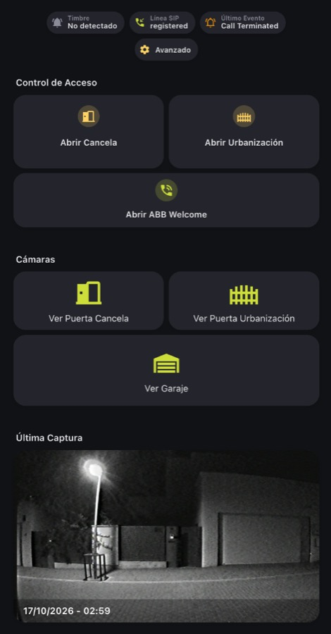
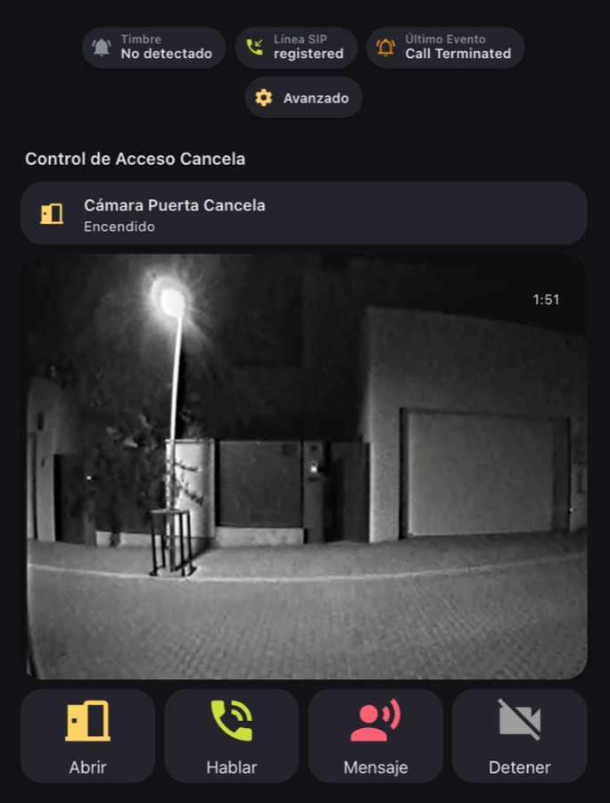
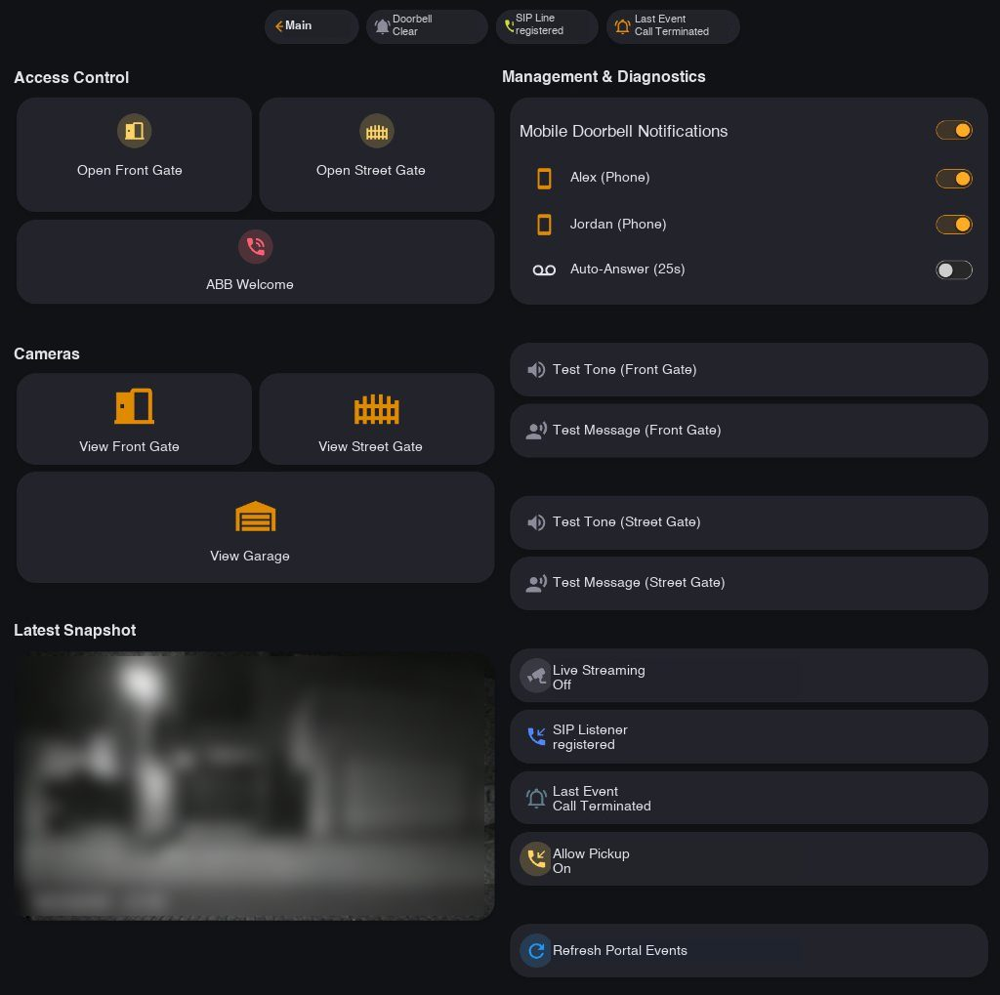

# Example dashboard and automations

<p align="center">
  
  &nbsp;
  
  &nbsp;
  
</p>

### Standby, Active Call, and Diagnostics UI Flow
* **In Standby:** Displays door unlock buttons, direct camera view triggers, and the latest visitor screenshot.
* **During a Ring / Active Call:** Reveals the live video feed (`camera.<gateway>_<door_name>`) with quick-action buttons:
  - **Open:** Unlocks the door (`button.press`).
  - **Message:** Broadcasts a pre-recorded absence message through the outdoor speaker (`abb_welcome.talk_audio_file`).
  - **Stop:** Disarms live streaming (`switch.turn_off`).
* **Technical & Diagnostics:** Shows live SIP listener state, last event, `allow_pickup` toggle, and `refresh_events` button.

<details>
<summary>Example Dashboard View YAML (replace <code>&lt;gateway&gt;</code> and <code>&lt;door_name&gt;</code> with your entity IDs)</summary>

```yaml
title: ABB Welcome Intercom
path: abb-intercom
icon: mdi:doorbell-video
type: sections
badges:
  - type: entity
    entity: binary_sensor.<gateway>_intercom_ringing
    name: Ringing
  - type: entity
    entity: sensor.<gateway>_sip_listener
    name: SIP Listener
  - type: entity
    entity: sensor.<gateway>_last_event
    name: Last Event
sections:
  - cards:
      - type: conditional
        conditions:
          - entity: switch.<gateway>_streaming_enabled
            state: "on"
        card:
          type: vertical-stack
          cards:
            - type: picture-entity
              entity: camera.<gateway>_<door_name>
              camera_view: live
              show_state: false
              show_name: false
            - type: grid
              columns: 3
              square: false
              cards:
                - type: button
                  name: Open
                  icon: mdi:door-open
                  tap_action:
                    action: perform-action
                    perform_action: button.press
                    target:
                      entity_id: button.<gateway>_<door_name>
                    confirmation:
                      text: Unlock the door?
                - type: button
                  name: Message
                  icon: mdi:account-voice
                  tap_action:
                    action: perform-action
                    perform_action: abb_welcome.talk_audio_file
                    data:
                      entity_id: camera.<gateway>_<door_name>
                      file_path: "/media/abb_welcome/intercom_mensaje.wav"
                - type: button
                  name: Stop
                  icon: mdi:video-off
                  tap_action:
                    action: perform-action
                    perform_action: switch.turn_off
                    target:
                      entity_id: switch.<gateway>_streaming_enabled
      - type: tile
        entity: button.<gateway>_<door_name>
        name: Unlock Door
        icon: mdi:door-open
      - type: button
        name: View Live Camera
        icon: mdi:video
        tap_action:
          action: perform-action
          perform_action: abb_welcome.arm_streaming
      - type: picture-glance
        title: Latest Screenshot
        image_entity: image.<gateway>_latest_screenshot
        entities:
          - entity: binary_sensor.<gateway>_intercom_ringing
  - cards:
      - type: entities
        title: Diagnostics & Controls
        entities:
          - entity: switch.<gateway>_streaming_enabled
          - entity: switch.<gateway>_allow_pickup
          - entity: sensor.<gateway>_sip_listener
          - entity: sensor.<gateway>_last_event
          - entity: button.<gateway>_refresh_events
```

</details>

### Automation: Doorbell Answering Machine (Absence Message)

Broadcast a pre-recorded 8 kHz mono 16-bit PCM WAV file to the outdoor station when someone rings the doorbell and nobody is home.

**Prerequisites:**
- Requires `abb_welcome.talk_audio_file` ([#43](https://github.com/rankjie/ha-abb-welcome/pull/43)).
- **Allow pickup** (`switch.<gateway>_allow_pickup`) must be enabled so Home Assistant can answer the pending incoming call (and arm streaming for the ringing station).
- The WAV file path must be allowlisted in Home Assistant. `/media/...` (Home Assistant's configured media directory) and `/config/www/...` are allowlisted by default; if you store files in another folder such as `/config/abb_welcome`, add it to `configuration.yaml`:
  ```yaml
  homeassistant:
    allowlist_external_dirs:
      - /config/abb_welcome
  ```

```yaml
alias: "ABB Welcome: Absence Message on Doorbell Ring"
description: "Broadcast an absence message to the outdoor station if home is unoccupied"
trigger:
  - platform: state
    entity_id: binary_sensor.<gateway>_intercom_ringing
    to: "on"
condition:
  - condition: state
    entity_id: group.family  # or person.your_name
    state: "not_home"
action:
  - delay: "00:00:03"  # Brief pause after first ring tone
  - action: abb_welcome.talk_audio_file
    data:
      entity_id: camera.<gateway>_<door_name>  # target the intended/ringing camera
      file_path: "/media/abb_welcome/intercom_mensaje.wav"
```

### Automation: Actionable Mobile Notification

Send an instant mobile notification with the visitor screenshot and handle the `OPEN_GATE` and `SEND_MESSAGE` button taps (for multi-door setups, bind `entity_id` to the intended/ringing camera):

```yaml
alias: "ABB Welcome: Doorbell Ring Notification & Actions"
mode: parallel
trigger:
  - platform: state
    entity_id: binary_sensor.<gateway>_intercom_ringing
    to: "on"
    id: ring
  - platform: event
    event_type: mobile_app_notification_action
    event_data:
      action: OPEN_GATE
    id: open_gate
  - platform: event
    event_type: mobile_app_notification_action
    event_data:
      action: SEND_MESSAGE
    id: send_message
action:
  - choose:
      - conditions:
          - condition: trigger
            id: ring
        sequence:
          - action: notify.mobile_app_<device>
            data:
              title: "Doorbell Ring!"
              message: "Someone is at the front gate."
              data:
                image: "/api/image_proxy/image.<gateway>_latest_screenshot"
                actions:
                  - action: "OPEN_GATE"
                    title: "Open Gate"
                  - action: "SEND_MESSAGE"
                    title: "Play Absence Message"
      - conditions:
          - condition: trigger
            id: open_gate
        sequence:
          - action: button.press
            target:
              entity_id: button.<gateway>_<door_name>
      - conditions:
          - condition: trigger
            id: send_message
        sequence:
          - action: abb_welcome.talk_audio_file
            data:
              entity_id: camera.<gateway>_<door_name>
              file_path: "/media/abb_welcome/intercom_mensaje.wav"
```
